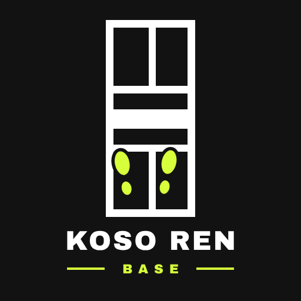

# KOSO REN TRAINING



バドミントンの基礎トレ（体幹・フットワーク）を音声カウントダウンで実施し、記録と連続日数（🔥ストリーク）を残す Web アプリ（PWA）です。
GitHub に push すると Cloud Run に自動デプロイされます。

## 機能
- **ホームからワンタップ開始**：メニューカードをタップ → 5秒前カウント → メニュー名を読み上げ → カウントダウン
- **音声ガイド**：開始前は残り3秒から「さん・に・いち」→「スタート」、トレーニング残り3秒から音声カウントで終了、インターバルは残り5秒からカウントして次のメニューへ
- **メニュー作成**：体幹／フットワークを選択 → メニュー名・秒数 → インターバル（なし／あり＋秒数）→「次のメニューを追加」→「終了して保存」
- **メニューの編集・削除**：ホームのカードの「⋯」から 開始／編集／複製／削除。編集画面では種目をタップして内容（名前・秒数・インターバル）を変更、▲▼で並べ替え、🗑で種目を削除
- **記録の削除**：記録画面の履歴から1件ずつ削除できます（連続日数にも反映）
- **連続記録**：Duolingo 風の🔥連続日数・直近7日・月カレンダー・最高記録・累計
- 一時停止／スキップ／中止、画面スリープ防止、オフライン動作、ホーム画面に追加可能

## 🎯 ランダム6点フットワーク
フットワークの種目で「やり方」を **🎯 ランダム6点** にすると、画面のコート（ネット側が上、左列 1-2-3・右列 4-5-6）の番号がランダムに赤く光り、音と読み上げ（「いち」「よん」…）で合図します。光った位置へ動いてセンターに戻る練習用です。

- 設定：セット数（1〜10）・1セットの秒数・合図の間隔（0.8〜5.0秒）・セット間の休憩
- 使う点：コートをタップして選ぶか、全部／前／後ろ／横／4隅 から選択（2点以上）
- 同じ点が3回続けて出ることはありません
- 終了画面と履歴に合図の回数（🎯合図N回）が残ります
- 普通のカウントダウン種目と同じメニューに混ぜて使えます


## 複数人で使う（アカウント）
- 最初に「誰がトレーニングする？」画面で**アカウントを選ぶだけ**（パスワードなし）。データはサーバー（Cloud Storage）に保存され、どの端末からでも同じ記録が見られます
- **アカウント管理**：「＋追加」で名前（とIDは任意）を入れて追加、「アカウントを管理」から ✎名前変更・🗑削除（削除するとその人のメニューと記録も消えます）
- ホーム右上の自分の名前をタップすると、いつでもアカウントを切り替え
- **👥みんな**タブ：メンバー一覧（連続日数・合計回数・最終トレーニング日）、IDか名前で検索。タップするとその人のメニューと記録が見られます
- **メニューをもらう**：他の人のメニューを開いて「＋ 自分のメニューに追加」。ホームのカードに 👤元の人 が表示されます
- 「サーバーを使わず、この端末だけで使う」も選べます。最初のアカウント追加時に、この端末の記録とメニューを引き継げます
- 電波がないときも端末に保存しておき、つながったら自動で同期します

> パスワードがないので、URLを知っている人は誰でもアカウントを選んだり削除したりできます。チーム内だけで共有してください。

## 通知（つつく・毎日のリマインド）
- **👉 つつく**：「みんな」タブで相手の「つつく」を押すと、その人のスマホに通知が届きます（何回でもOK。連打防止で同じ相手へは30秒あける。今日もう練習した人・通知オフの人には送れません）
- **毎日のリマインド**：決めた時刻（17〜22時、初期値22時）に、その日まだトレーニングしていない人へ自動で通知（1日1回）
- 受け取る人は、記録画面の「通知」→「通知をオンにする」で許可します
  - **iPhone**：iOS 16.4以降。Safariの共有ボタン →「ホーム画面に追加」→ そのアイコンから開いて設定（Safariのままでは届きません）
  - **Android**：Chromeならそのまま設定できます
- 通知用の鍵（VAPID）は初回に自動で作られ、バケットの `config/vapid.json` に保存されます
- アカウントを切り替えると、その端末の通知の届け先も切り替わります

### 毎日のリマインドに必要な設定（Cloud Scheduler）
毎日17〜22時の毎正時に `/api/cron/reminders` を呼ぶジョブを1つ作ります（つつくだけなら不要）。

```bash
gcloud services enable cloudscheduler.googleapis.com --project ramen-log-515610
gcloud scheduler jobs create http koso-ren-reminders --project ramen-log-515610 \
  --location asia-northeast1 --schedule "0 17-22 * * *" --time-zone "Asia/Tokyo" \
  --uri "https://badminton-training-698636063892.asia-northeast1.run.app/api/cron/reminders" \
  --http-method POST
```

コンソールなら：Cloud Scheduler →「ジョブを作成」→ リージョン `asia-northeast1`、頻度 `0 17-22 * * *`、タイムゾーン「日本標準時」→ ターゲット HTTP、URL は上記、メソッド POST。
（任意）Cloud Run に環境変数 `CRON_SECRET` を設定した場合は、ジョブのヘッダーに `X-Cron-Secret: <同じ値>` を追加してください。

## フォルダ構成
```
server.js          サーバー（静的配信＋API）。Cloud Run では Cloud Storage、ローカルでは data/db.json に保存
public/            アプリ画面（HTML/CSS/JS、PWA）
package.json       依存ライブラリ（@google-cloud/storage、web-push）
Dockerfile         Cloud Run 用イメージ（Node.js 22）
```

## ローカルで動かす
```bash
npm install
npm run dev        # → http://localhost:8080 （data/db.json に保存）
```

## 初回だけ：Cloud Storage の準備（アカウント機能に必要）
データはバケットの中に `users/<ID>.json`（名前など）と `userdata/<ID>.json`（メニュー・記録）として保存されます。
Cloud Shell で（`PROJECT_ID` を置き換え。サービス名・リージョンが違う場合は合わせる）：

```bash
PROJECT_ID=your-project-id
BUCKET=$PROJECT_ID-badminton-data

# 1. バケットを作る（非公開・東京）
gcloud storage buckets create gs://$BUCKET --project $PROJECT_ID \
  --location=asia-northeast1 --uniform-bucket-level-access --public-access-prevention

# 2. Cloud Run のサービスアカウントにバケットの読み書き権限をつける
SA=$(gcloud run services describe badminton-training --region asia-northeast1 --project $PROJECT_ID --format='value(spec.template.spec.serviceAccountName)')
[ -z "$SA" ] && SA="$(gcloud projects describe $PROJECT_ID --format='value(projectNumber)')-compute@developer.gserviceaccount.com"
gcloud storage buckets add-iam-policy-binding gs://$BUCKET --member="serviceAccount:$SA" --role=roles/storage.objectUser

# 3. Cloud Run にバケット名を教える（環境変数 BUCKET）
gcloud run services update badminton-training --region asia-northeast1 --project $PROJECT_ID --update-env-vars BUCKET=$BUCKET
```

コンソールでやる場合：「Cloud Storage」→「バケットを作成」（東京・公開アクセス防止オン）→ バケットの「権限」で Cloud Run のサービスアカウントに「Storage オブジェクト ユーザー」を追加 → Cloud Run のサービス →「新しいリビジョンの編集とデプロイ」→ 変数とシークレットに `BUCKET` = バケット名。

> BUCKET を設定していないと、アカウント画面に「保存先が設定されていません」と出ます（その間も「この端末だけで使う」は使えます）。
> 少人数で使う分には、Cloud Storage の無料枠内に収まる見込みです。

## デプロイ方法
Cloud Run の「リポジトリから継続的にデプロイ」（ビルドタイプ：Dockerfile）を設定していれば、main に push／マージするだけで反映されます。
未設定なら：Cloud Run →「サービスを作成」→「リポジトリから継続的にデプロイする」→ このリポジトリ・`main`・Dockerfile、リージョン `asia-northeast1`、「未認証の呼び出しを許可」、ポート `8080`。

## カスタマイズ
- 開始前カウント秒数・音声カウント開始秒数：`public/app.js` 冒頭の `PREP_SEC` / `REST_COUNT_FROM` / `WORK_COUNT_FROM`
- 種目の候補（チップ）：`PRESETS`
- アプリ更新がスマホに反映されないとき：`public/sw.js` の `VERSION` を上げる

## 補足
- 音声は端末の読み上げ機能（Web Speech API）を使います。iPhone はマナーモードだと音が出ないことがあります。
- 画面ロック中はブラウザの仕様でカウントが止まることがあるため、トレーニング中は画面をつけたままにしてください（スリープ防止は自動でかけています）。
